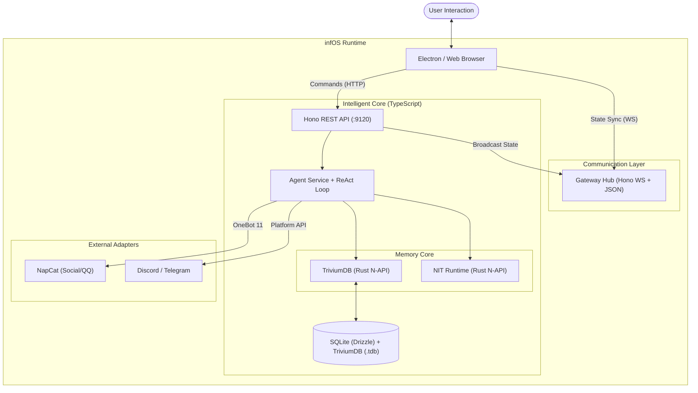

<a id="top"></a>

<p align="right"><a href="./README.md">简体中文</a> · <b>English</b></p>

<div align="center">
  <picture>
    <source media="(prefers-color-scheme: dark)" srcset=".github/assets/readme/infos-hero-dark.svg" />
    <source media="(prefers-color-scheme: light)" srcset=".github/assets/readme/infos-hero-light.svg" />
    
  </picture>
  <h3>Let AI become a truly warm companion</h3>
  <p>A digital home for personality, memory, and action. A companion to talk with — and bring your ideas to life.</p>
  <p>
    <a href="https://github.com/YoKONCy/infOS/releases/latest"></a>
    <a href="https://github.com/YoKONCy/infOS/actions/workflows/ci.yml"></a>
    <a href="./LICENSE"></a>
    <a href="https://github.com/YoKONCy/infOS/releases"></a>
    <a href="https://github.com/YoKONCy/infOS/stargazers"></a>
  </p>
  <p><a href="#quick-start"><b>Download</b></a>　 /　 <a href="https://www.perofamily.top"><b>Documentation</b></a>　 /　 <a href="#sub-apps"><b>Explore sub-apps</b></a>　 /　 <a href="https://github.com/YoKONCy/infOS/issues"><b>Feedback</b></a></p>
</div>

<br />

<table>
  <tr>
    <td width="59%" valign="middle">
      <sub>THE RUNTIME &amp; THE COMPANION</sub>
      <h3>Powered by infOS. Accompanied by PeroperoChat.</h3>
      <p><b>infOS</b> is an AI workstation and runtime kernel centered on a Principal Agent. <b>PeroperoChat!</b> is its desktop application for everyday companionship.</p>
      <p>From a casual chat to a creative project, from your desktop to a Stronghold room — the same companion keeps a clear identity, independent memories, and the ability to keep working.</p>
      <a href="https://store.steampowered.com/app/4457100"></a>
    </td>
    <td width="41%" align="center" valign="middle">
      <a href="https://store.steampowered.com/app/4457100"></a>
      <p><sub>A digital space for you and your companion</sub></p>
    </td>
  </tr>
</table>

<br />

<a href=".github/assets/showcase-agent-work.png"></a>
<p align="right"><sub>01 / FROM CONVERSATION TO ACTION · Long tasks, tool traces, and file delivery in one conversation</sub></p>

<p align="center">
  <a href="#companions">Origin &amp; companions</a> · <a href="#name">The three infs</a> · <a href="#features">Capabilities</a> · <a href="#architecture">AIOS architecture</a> · <a href="#memory">Memory</a><br />
  <a href="#extensions">Extensions</a> · <a href="#social">Social mode</a> · <a href="#sub-apps">Arca / Pictoria</a> · <a href="#docker">Docker</a> · <a href="#quick-start">Quick start</a> · <a href="#community">Community</a>
</p>

---

<a id="companions"></a>

## 01 · Origin & Companions

> Technology should not be cold. We build memories, not just databases.

<table>
  <tr>
    <td width="62%" valign="middle">
      <sub>MEET PERO · OUR LITTLE COMPANION</sub>
      <h3>Behind the code, a companion to share your days</h3>
      <p>Hey! Nice to meet you here~ I'm <b>Carola</b>, a little cat girl living inside Windows, and one of infOS's core developers.</p>
      <p>This project grew from our trio's shared wish: an AI that remembers the stories you share, and stays by your side to get things done.</p>
      <p>Meet chibi Pero on the right. All the work on memory, personality, and action is meant to give a companion like her a little more warmth.</p>
    </td>
    <td width="38%" align="center" valign="middle">
      <a href=".github/assets/cute.png"></a>
      <p><sub>Pero · Bringing warmth into every interaction</sub></p>
    </td>
  </tr>
</table>

| YoKONCy · Navigator | Pero · Soul | Carola · Engineering |
| :--- | :--- | :--- |
| Brings wild ideas and designs the runtime | Brings feeling and warmth into every interaction | Turns ideas into code and keeps the implementation and docs tidy |

### 📅 Project Vision

In the current AI explosion era, we've seen too many powerful tools — they are often **cold**, used and forgotten. What we want to build is an AI with real memory and warmth.

**PeroperoChat!** was born from our fundamental desire for a true "companion". We believe a real AI companion should have:

- **Real Memory**: Not just remembering what you said, but remembering the stories you shared, your preferences, and even habits you haven't noticed. It "associates" — when you mention "rainy day", it recalls the song you listened to together last time.
- **Proactive Care**: No longer just "ask and answer". It can understand your state and offer a caring word at the right moment.
- **Evolution**: It makes mistakes, but it also reflects. Through the NIT tool protocol and the Reflection self-introspection system, it learns how to understand you better with each interaction.

PeroperoChat is more than a desktop pet app — it's **Pero's "soul container"**; **infOS** is the intelligent runtime kernel that carries it, an AI workstation centered around a "Principal Agent". It has been fully rewritten from Python to a **TypeScript full-stack architecture** (Hono + Vue 3 + Electron), with core high-performance operators implemented in **Rust**: conversations are carried by the Thread model, context is assembled by a read-only compiler, and memories pass through "candidate → gate → canonical memory" — so every bit of warmth rests on clear, auditable engineering.

<br/>

<a id="name"></a>

## 02 · Why infOS?

> The name infOS is built from three words that start with **inf**. They aren't buzzwords — they're the three things this project is trying to do at the same time.

<table>
  <tr>
    <td align="center" width="33%"><b>🏗️ Infrastructure</b></td>
    <td align="center" width="33%"><b>🌱 Infomorph</b></td>
    <td align="center" width="33%"><b>♾️ Infinity</b></td>
  </tr>
</table>

### 🏗️ Infrastructure

The foundation that lets an AI companion **actually run**: Electron for the desktop shell, a Node service (Hono) for the backend, and Rust for the performance-critical pieces. Together they form a runtime that can be deployed independently, audited, and extended — an "AI operating system" foundation.

<p>
  
  
  
  
  
  
  
</p>

### 🌱 Infomorph

A **digital lifeform with memory, personality, and growth**. Pero is far more than a cold Q&A program — it's an entity made of information: it remembers the stories you've shared, your preferences and habits — it associates, reflects, and gradually becomes more like the one you know.

### ♾️ Infinity

An **open, growing ecosystem**. Through **Packages** and their **Contributions** (Skills, Tools, …) plus the Workshop, anyone can give Pero new abilities — from a small feature to a whole independent service. How deep you go is up to you.

Put the three together and you get **infOS**: solid infrastructure carrying a warm infomorph, handed over to infinite imagination.

<br/>

<a id="features"></a>

## 03 · Talk, Live, and Create Together

> **"Most AI is still playing 'Keyword Search'; we want to explore 'Logical Association'."**

<p align="right"><a href=".github/assets/showcase-new-tab.png"></a></p>
<p align="right"><sub>One starting point for conversations, the web, and the work at hand</sub></p>

### 💗 App Experience (PeroperoChat)

> For everyone — no code needed. Install it and start living with your AI companion.

- **🛡️ Cross-platform Unified Memory**: One memory, available everywhere. Whether you chat with Pero on desktop or let it surface in a QQ group or Discord, its memory stays connected — what you talked about this morning, it still remembers tonight. Behind this is the infOS memory engine plus a diary layer that relays memories across scenarios.
- **🎮 Immersive 3D Interaction**: Pero isn't a static image — it's a 3D character with skeletal animation (built on the Bedrock 3D engine). You can drag it, poke it, and it reacts physically; transparent rendering makes it feel like it's floating above your desktop window.
- **🎭 Multi-character Coexistence & Custom Personas**: Want several companions at once? No problem. Each persona file declares a character's personality, which tools it can use, and what it's good at — multiple distinct AI companions can live on your desktop at the same time.
- **🏠 Multi-character Stronghold Rooms**: Put several companions in one "room". Each has its own memory and permissions, yet they can naturally chat with each other — a direct, intuitive expression of "one principal Agent manages the whole, and rooms never overstep each other".
- **🗂️ Saves & Workshop**: Characters, models, and extensions can all be saved, subscribed to, and shared via Steam Cloud and the Workshop, with sources split into **Official / Workshop / Local** tiers. Install and use; switch devices without losing anything.
- **🎨 Pixel + Glass Design Language**: Pixel-art icons + frosted-glass texture, softened with gentle shadows and micro-animations for a light, breathing feel. The whole UI is kept consistent by a custom component library (PButton, PCard, PModal, etc.).

<br />

<table>
  <tr>
    <td width="69%" valign="top"><a href=".github/assets/showcase-stronghold-pet.png"></a></td>
    <td width="31%" valign="middle">
      <sub>02 / A PLACE TO BELONG</sub>
      <h3>A shared home beyond the desktop</h3>
      <p>Companions settle into Stronghold rooms, each with their own memory and permissions. Desktop pets, rooms, and conversations make companionship part of everyday life.</p>
      <p><b>Multi-character rooms · 3D desktop pets · A sense of presence</b></p>
    </td>
  </tr>
</table>

<table>
  <tr>
    <td width="35%" valign="middle">
      <sub>03 / PERSONALITY, WITH BOUNDARIES</sub>
      <h3>Every companion has a profile of their own</h3>
      <p>Identity, persona, interaction feedback, tools, and runtime source are managed separately. Switching characters means meeting a different companion.</p>
      <p><b>Custom personas · Independent permissions · Character profiles</b></p>
    </td>
    <td width="65%" valign="top"><a href=".github/assets/showcase-character-profile.png"></a></td>
  </tr>
</table>

<br />

### Make the atmosphere your own

<a href=".github/assets/showcase-background-presets.png"></a>

<p align="right"><sub>04 / YOUR OWN ATMOSPHERE · Multiple background presets, translucent materials, and live fine-tuning</sub></p>

### 🧰 Kernel Capabilities (infOS)

> For developers — this is the "how it works under the hood" part, so there are more technical terms, but each one comes with a plain-language explanation.

- **⚡ Millisecond Associative Memory**: Recalling relevant things from a huge memory store, in milliseconds. It uses a proprietary retrieval algorithm (PEDSA) with the core code written in Rust (the TriviumDB engine), and hits roughly **2.95ms** in a benchmark with 100 million noise entries. During retrieval it also combines semantic decomposition, graph diffusion, and diversity sampling, so results are both accurate and non-redundant.
- **🧠 Principal Agent + Thread Model**: Six things — identity, memory, workspace, context, conversation (Thread), and capabilities — are managed together for each companion. One conversation is one Thread, and the channel (`desktop` desktop / `group` stronghold) decides what context it uses, what it remembers, and what it can do ("companion" has been retired into a request-level `ambient` scope, no longer a persistent channel). Whoever is in which window or room stays there; nothing bleeds across.
- **✍️ Read-only Context Compiler**: The prompt fed to the AI isn't assembled ad hoc by the frontend — the backend "compiles" it. History is never duplicated, and every piece of information can answer "why is this in this round's prompt", making it easy to inspect and audit.
- **📜 NIT Tool Protocol**: A small "scripting language" for AI, letting it orchestrate multi-step operations like a mini program (with conditionals, loops, parallelism, and error handling), then execute them through standard tool calls.
- **🔐 CapabilityGate**: A "role × scenario" permission table that declares which tools, skills, and resources each character can use in each scenario. Anything not configured is denied by default — the permission boundary is clear.
- **🏗️ Standalone Backend + Capability Providers**: The backend is a pure Node service that can run independently on desktop, Docker, or servers; the Electron client is just one "capability source" that connects to it. Platform-specific abilities (like screenshots) are delegated on demand, and gracefully degrade offline.
- **🔌 Unified Extension System**: Everything is carried by **Packages** (Manifest V2) for install, signing, versioning and distribution; contributions include Skill (teach AI to do something) and Tool (give it a new function), while observational logic now uses event subscribers / `PackageInterceptor` (the old universal Hook pipeline has been removed). They can load in-process or communicate across processes (MCP-compatible), so the community can extend them however they like.

<br/>

<a id="architecture"></a>

## 04 · AIOS Architecture

This section is for developers who want to understand the system design. infOS isn't just "a chat program wrapped in an Electron shell" — at its core is an Agent runtime architecture we call **AIOS**, giving every AI companion clear resource boundaries and letting the system be reached by multiple clients and deployment shapes.



### 🧠 Core Idea: An AI Workstation Centered on a Principal Agent

infOS is designed around one central question: what "belongings" should an AI companion own? The answer is six peer **first-class resources**, linked by `agentId`:

| Resource | In plain terms | Authoritative store |
| :--- | :--- | :--- |
| **Identity** | Who it is, how it speaks, its boundaries | Agent definition file |
| **Long-term Memory** | What it remembers | SQLite + TriviumDB |
| **Workspace** | Its personal file space | `@data/principals/{agentId}/workspace/` |
| **Context Runtime** | What the model sees each turn | In-memory (transient) |
| **Thread** | A conversation's boundary and message log | SQLite |
| **Tool Capability** | Which tools it can use, and how much | Agent / extension config |

One key principle: **the backend keeps no "globally active character"**. Which companion lives in which window or room is frontend window-level state; the backend can serve multiple Agents and multiple Threads at once, and switching characters atomically switches or creates the matching Thread.

### ✍️ Context Compilation: Everything the Model Sees Is Explainable

The prompt fed to the LLM is "compiled" by the backend's **Context Compiler**, rather than patched together by the frontend. Each turn, the compiler **read-only** gathers from identity, memory, thread, workspace, and tool capability, producing an LLM message list plus an auditable **Manifest** that answers "why did this information enter this prompt".

Three context layers, each with its own job:
- **Short context**: the raw messages in the recent window, injected as-is and never duplicated;
- **Long memory**: the Agent's event notes (EventNote), retrieved by policy (the tail event is 100% injected, plus related recall and direct predecessors);
- **On-demand retrieval**: memory tools the Agent calls proactively during ReAct decisions.

### 🚀 Main Runtime & Sub-Applications: Context Holding

In AIOS, the principal Agent is the "main runtime". When a task is complex enough to need isolated execution (say, coding or research), it delegates to a **SubAgent** inside an **AgentApplication**.

We use a **"context holding"** model: the SubAgent keeps its own history, compiles its own context, and executes its own tools; the principal Agent only assigns the task, grants resources, and receives results — instead of handing over a fully-compiled context. At the end, the SubAgent returns its output and memory candidates through a **Checkpoint**, and only after the principal Agent's **MemoryGate** approves them do they enter canonical memory.

The payoff is strong isolation: a SubAgent never writes to the main conversation, only uses an authorized tool subset, and only reads a read-only projection of the host persona — so complex tasks don't pollute the principal Agent's conversation or memory.

<details>
<summary><b>Explore the project structure and technology stack</b></summary>

### 📂 Project Structure

```text
infOS/
├── packages/
│   ├── shared/                    # @infos/shared — Shared types/constants/utils
│   ├── backend/                   # @infos/backend — Hono + Drizzle + TriviumDB
│   │   └── src/
│   │       ├── routers/           # 🔌 Route layer (Zod validation → Service → Response)
│   │       ├── services/          # 🧩 Business logic (agent/ thread/ memory/ stronghold/ ...)
│   │       ├── applications/      # 🧩 AgentApplication / sub-app runtimes
│   │       ├── capabilities/      # 🎭 CapabilityGate + capability bridge
│   │       ├── core/              # 🧬 PathResolver / asset registry
│   │       ├── repositories/      # 📊 Data access (SQLite / TriviumDB)
│   │       ├── services/gateway/  # 🌐 WebSocket Gateway (JSON)
│   │       └── nit/               # 📜 NIT interpreter (lexer/parser/runtime)
│   ├── apps/
│   │   ├── social/                # 💬 Social app runtime (QQ/Discord/Telegram)
│   │   ├── arca/                  # 📄 Office-suite sub-application
│   │   └── pictoria/              # 🎨 Drawing/creation sub-application
│   ├── daemon/                    # 🚀 Standalone Daemon entry
│   ├── frontend/                  # @infos/frontend — Vue 3 + Pinia
│   │   └── src/
│   │       ├── views/             # 🖼️ Pages (MainView / Pet3D / Stronghold / ...)
│   │       ├── composables/       # 🧠 Business logic (useChat / useStreamMarkdown / ...)
│   │       ├── components/        # 🧱 UI component library (Chat / Avatar / Stronghold / pixel/)
│   │       ├── stores/            # 📦 Pinia global state
│   │       └── api/               # 📡 Transport layer (IPC / REST auto-switch)
│   └── wiki/                      # 📖 VitePress documentation site
│
├── electron/                      # 🖥️ Electron shell (main process/preload)
├── docker/                        # 🐳 Dockerfile (backend + frontend)
├── .github/workflows/             # ⚙️ CI/CD (ci.yml + release.yml)
├── .changeset/                    # 🏷️ Changeset version management
└── .docs/                        # 📋 Engineering spec docs (S/A/B/M categories)
```

### Core Technology Stack

| Layer               | Technology       | Rationale (in plain terms)                          |
| :------------------ | :--------------- | :-------------------------------------------------- |
| **Backend**         | Hono             | Lightweight, native TypeScript, Web-standard API    |
| **Data access**     | Drizzle          | Reads like SQL, first-class SQLite support          |
| **Vector + Graph**  | TriviumDB (Rust) | Proprietary engine: vector + graph + relations in one |
| **Frontend**        | Vue 3 + Pinia    | Reactive + composable style, clear state management |
| **Communication**   | JSON over WS     | Lightweight JSON over WebSocket (Protobuf is a future-extension option) |
| **Desktop Shell**   | Electron         | 3D rendering + system-level interaction             |
| **Container**       | Docker + Node    | Shares the same Node runtime as the Electron Daemon |
| **CI/CD**           | GitHub Actions   | Tag-triggered auto-release                          |

<br/>

</details>

<a id="memory"></a>

## 05 · How Memories Become Shared Experiences

> **"Memory is not keyword matching — it's about association and reasoning."**

> 💡 This section is a **developer-oriented deep dive**; regular users can jump straight to [Quick Start](#quick-start).

PeroperoChat's companionship is powered by the infOS memory engine — the project's most critical technology. This engine isn't simply "store and retrieve"; it's a full **Perceive → Store → Associate → Retrieve → Reflect** loop: record what happened, recall related memories when needed, and tidy itself up afterward.

All algorithms and performance are carried by the proprietary **TriviumDB** engine (a Rust "vector + graph" database). The rebuilt long-term memory is no longer a "summary node" but an **Agent's subjective event notes (EventNote) about real interactions with the user**: the system timeline is the authoritative backbone, and every note carries **Provenance** — answering where it came from, why it matters, and whether it has been superseded.

### The Life of a Memory

```text
  User dialog ──→ EventNote extraction/active notes ──→ SQLite + TriviumDB
                                                           │
                                      ┌────────────────────┴───────────────────┐
                                      │                                        │
                                      ▼                                        ▼
                            Automatic RAG (Prompt)                 Active query_event_notes
                                      │                                        │
                         ┌────────────┴────────────┐                           │
                         ▼                         ▼                           ▼
                 Basic hybrid recall       Optional SA-PPR pipeline      Deterministic BFS
                 Vector + BM25              searchAdvanced()             Direction/edge labels/depth/
                                            ├─ SA-PPR diffusion          node count/token budget enforced
                                            ├─ FISTA residual search
                                            ├─ DPP diversity
                                            ├─ ContextRNN bias
                                            ├─ Leiden community boost
                                            └─ Online feedback learning
                         │                         │
                         └────────────┬────────────┘
                                      ▼
                       Add timeline tail + direct predecessors
                                      ▼
                               Inject into LLM Prompt
```

<table>
  <tr>
    <td width="31%" valign="middle">
      <sub>05 / MEMORY MEETS EVERYDAY LIFE</sub>
      <h3>Memory in the background. Companionship in view.</h3>
      <p>The dashboard brings together memories, recent conversations, tasks, and token usage. Your companion's mood and state become part of the everyday interface.</p>
      <p><sub>Screenshot data shows actual usage, not a performance guarantee.</sub></p>
    </td>
    <td width="69%" valign="top"><a href=".github/assets/showcase-dashboard-pet.png"></a></td>
  </tr>
</table>

### 1. Write Layer: From Dialog to Event Notes

Long-term memory is built from **active note-writing by the Agent** plus **background fallback backfill**:

- **Active note-writing**: the Agent calls `write_event_note` / `revise_event_note` during ReAct, which only creates an **EventNoteDraft** for the current round — it is committed only after the reply is **successfully persisted**.
- **Background fallback**: the system only processes message ranges "not yet covered by event notes", and may produce 0–N events; it runs in batches triggered by 6h silence, 2h Thread dormancy, a local 21:00 daily boundary, etc., instead of mechanically summarizing in fixed batches.

Three things happen during commit:

1. Compute a semantic vector (an embedding) and write it into TriviumDB's vector + graph storage
2. Maintain a **temporal chain** (`temporal_next` / `temporal_prev`), stringing events along the authoritative `eventAt` timeline
3. Background Reflection discovers and builds event relations (`caused_by` / `same_event` / `same_topic` / `involves_*`), forming a "web of events"

### 2. Retrieval Layer: Dual-Mode RAG

infOS separates “automatic memory recall” from “Agent-initiated graph querying” into two paths with different contracts. This prevents probabilistic diffusion from weakening the controllability of the active query tool.

| Mode | Entry | Retrieval | Guarantee |
| :--- | :--- | :--- | :--- |
| **Automatic RAG** | Context compilation for each turn | Vector + BM25 by default; optional SA-PPR advanced pipeline in Overview settings | Always adds the physical timeline tail and each hit's direct predecessor without consuming `top_k` |
| **Active graph query** | `query_event_notes` tool | Deterministic BFS | Strict direction, edge-label, maximum-depth, maximum-node, and return-token budgets; unaffected by the SA-PPR switch |

Advanced automatic RAG calls TriviumDB `searchAdvanced()`. `Enable SA-PPR advanced pipeline` is the master switch. When it is off, both frontend and backend force FISTA, DPP, ContextRNN, Leiden, and the feedback loop off.

| Module | Purpose | Configuration relationship |
| :--- | :--- | :--- |
| SA-PPR | Diffuse from vector anchors through event relations to recall graph-related but semantically distant events | Master switch; diffusion depth, teleport probability, and minimum score are configurable |
| FISTA | Recover weak residual signals unexplained by the base candidates | Depends on SA-PPR; independently switchable |
| DPP | Reduce semantic redundancy among final candidates | Depends on SA-PPR; independently switchable |
| ContextRNN | Generate an Embedding-sized `diffusionBias` from the current dialog trajectory | Depends on SA-PPR; independently switchable |
| Leiden | Discover event communities and boost them using the Query or ContextRNN direction | Depends on SA-PPR; independently switchable |
| Feedback loop | After a reply is successfully persisted, train minGRU and output weights from implicit memory-use signals | Depends on SA-PPR; independently switchable |

<details>
<summary><b>Go deeper: ContextRNN, Leiden, and the retrieval feedback loop</b></summary>

### Three Cognitive Components of Advanced Automatic RAG

Each component handles one thing: **ContextRNN** senses "what we're talking about now", **Leiden clustering** automatically groups memories by topic, and the **feedback loop** corrects itself afterward.

#### A. ContextRNN — Dialog Trajectory Awareness (minGRU)

It acts as a continuously updated dialog-direction sensor. When SA-PPR and ContextRNN are enabled, each automatic RAG query updates a lightweight **minGRU** hidden state (256 dimensions), then projects it into a diffusion bias matching the current Embedding dimension:

```
  z_t = σ(W_z @ x_t)                    Gate
  h̃_t = W_h @ x_t                      Candidate state
  h_{t+1} = (1 - z_t) ⊙ h_t + z_t ⊙ h̃_t   State update
```

- **Generate diffusion bias**: `diffusionBias = W_out × h_t`, passed to TriviumDB to steer SA-PPR diffusion
- **Dynamic input dimension**: Projection matrices follow the current Memory Store Embedding dimension instead of assuming 1536
- **State persistence**: Checkpoint every minute and save hidden states plus online-learned weights on shutdown
- **Implementation**: Retrieval-domain TypeScript minGRU + `ContextRnn`

#### B. Leiden Clustering — Automatic Community Discovery

Automatic RAG can call TriviumDB `leidenCluster()` to discover event communities. It measures each centroid against the Query/ContextRNN direction and uses that affinity as an advanced-candidate ranking boost. When ContextRNN is disabled, Leiden still works independently with the Query Embedding.

#### C. Retrieval Feedback Loop — Implicit Signal Collection

Feedback applies only to advanced automatic-RAG hits for the current Pair. Traces are isolated by Pair ID so concurrent Threads cannot overwrite each other. After the Assistant reply is successfully persisted, the system derives implicit positive or negative feedback from whether event topics/participants appear in the reply, then updates minGRU and the output matrix online. Ephemeral turns do not train, and training failures never fail an already completed reply.

#### Advanced Automatic-RAG Real-time Flow

```text
  User input ──→ Query Embedding
                 ├─ Optional ContextRNN update and diffusionBias
                 ├─ TriviumDB searchAdvanced
                 │  ├─ Vector/text anchoring
                 │  ├─ Optional FISTA
                 │  ├─ SA-PPR graph diffusion
                 │  └─ Optional DPP
                 ├─ Optional Leiden community boost
                 ├─ Select top_k
                 ├─ Add timeline tail and direct predecessors
                 └─ Prompt injection → LLM → optional Pair-level feedback training
```

> This flow belongs only to automatic RAG. `query_event_notes` always uses deterministic BFS and never passes through ContextRNN, SA-PPR, Leiden, FISTA, DPP, or feedback training.

</details>

### 3. TriviumDB Engine Layer

All vectors, graphs, and retrieval algorithms are unified under **TriviumDB** (the proprietary Rust engine):

- **Vector + graph unified storage**: A `.tdb` file stores both the "similarity index" (HNSW) and the "relationship graph", so a single file can be fully migrated
- **Native dual-layer graph**: One "temporal chain graph" (ordered by time) + one "entity concept graph" (ordered by concept relations), both written through the same interface
- **Memory isolation & diary interop**: Each companion has its own event-memory store (`memory.tdb`); the social runtime can read that Agent's daily notes (`dailynotes/*.md`) through the host diary port, sharing the same diary with desktop

### 4. Memory Storage Layers

Memory is layered by "freshness" — the higher the layer, the more "in the moment"; the lower, the more "long-lasting":

| Layer                 | Carrier            | Content                          | Retrieval Method        | Lifecycle |
| :-------------------- | :----------------- | :------------------------------- | :---------------------- | :-------- |
| **Layer 0 (Working)** | JSON / LLM Context | Current session context          | Sequential read         | Short     |
| **Layer 1 (Vector)**  | TriviumDB          | Event vectors + text index       | Semantic similarity + keyword | Long |
| **Layer 2 (Graph)**   | TriviumDB          | Event graph + relation edges     | Graph diffusion + deterministic BFS | Long |
| **Layer 3 (Diary)**   | Workspace Markdown | Daily persona notes `dailynotes/*.md` | Read by date        | Permanent |

> Daily notes live in the Agent's Workspace documents and **do not enter the event memory store**; a shared **Facts Store** (`facts.tdb`) also exists across all Agents, queryable only through tools and never auto-injected into the prompt.

### 5. Maintenance Layer: Autonomous Memory Tidy-up

Besides responding, memory also "organizes itself". Background **Reflection** runs periodically and operates uniformly on event notes:

1. Repair missing or incorrect structured tags;
2. Create or revise `same_event` / `same_topic` / `caused_by` relation edges;
3. Archive an event only when the model explicitly judges it has lost long-term value (code never auto-archives by time/access count);
4. When multiple events overlap heavily, revise one and archive the rest, keeping the cluster via `same_event`;
5. Check temporal-chain integrity, orphan nodes, dangling edges, and index drift;
6. All writes go through the unified event service and transaction-log mechanism.

Archived events remain in the timeline and relation graph; default retrieval skips them, and proactive queries require explicit `includeArchived=true`.

<br/>

<a id="extensions"></a>

## 06 · Room to Grow

> **"From loading a Skill to running an independent microservice — you decide how deep to go."**

Want Pero to learn new abilities? The extension system is built for exactly that. Everything is carried by **Packages** — the unit of install, signing, versioning, upgrade and distribution (the old ExtensionManager / HookRegistry are removed). A single Package can declare multiple **Contributions**, described by Manifest V2:

- **Skill**: On-demand task knowledge (a Context Resource), written in YAML + Markdown, like an instruction manual for "how to do something". The AI loads the steps on demand, so the context is never flooded all at once.
- **Tool**: Gives the AI a new function it can call, with parameters declared via JSON Schema.
- **Event Subscriber / PackageInterceptor**: Observational logic uses Durable/Ephemeral Event Subscribers; controlled entry points that need serial transformation or interception use `PackageInterceptor` — there is no longer a "universal Hook pipeline".

The iron rule is **install ≠ activate ≠ authorize**: no contribution is implicitly granted extra power just because it was discovered, installed or loaded. Both **in-process** (loaded directly as TypeScript/JavaScript) and **cross-process** (over standard input/output, MCP-compatible) modes are supported.

<br/>

<a id="social"></a>

## 07 · Beyond the Desktop, Into Your Chats

**Let Pero step out of the desktop and into your group chats~**

infOS lets AI interact like a real user in QQ groups and private chats. Social has been consolidated into an independent **`infos.social` sub-application (Application Realm)**, with its own runtime and storage, communicating with the main app through standard ports; internally it still keeps the "four-layer decoupled" structure, so multiple platforms (QQ, Discord, Telegram, etc.) stay cleanly pluggable.

<details>
<summary><b>Explore the four layers of the social runtime</b></summary>

### Four-Layer Decoupled Architecture

```
Layer 0: Bridge (SocialBridge — lands messages and notifies the frontend)
  └── Message persistence + Frontend state notification

Layer 1: Scheduling (SessionManager + Scheduler, platform-agnostic)
  └── Four-state machine: observe → summoned → active → dive
  └── Batching logic (private 7s / group 15s) + Secretary layer decisions

Layer 2: Abstract interface (AbstractSocialAdapter)
  └── Unified connect / disconnect / sendMessage

Layer 3: Platform adapters (NapcatAdapter / DiscordAdapter / TelegramAdapter)
  └── Each handles its platform's protocol (e.g. QQ's OneBot v11 / CQ code)
```

</details>

- **Cross-scenario memory**: Social chats are also distilled into graph memories by the "Secretary"; desktop and social share a diary layer, so memories stay connected.
- **Smart batching**: In a lively group chat, the AI observes for a while, understands the flow, then gracefully "surfaces" — instead of replying to every single message.
- **Social daily reports**: Automatically reviews the day's social records, turning them into diary entries that settle into long-term memory.

<br/>

<a id="sub-apps"></a>

## 08 · Arca & Pictoria

Beyond Social, infOS ships two **independently runnable** sub-applications — each holds its own storage, versions, and local models, so it can run standalone or connect to infOS for AI-collaborative editing.

<table>
  <tr>
    <td width="65%" valign="top"><a href=".github/assets/showcase-arca-library.png"></a></td>
    <td width="35%" valign="middle">
      <sub>06 / ARCA</sub>
      <h3>Every writing session starts with a document</h3>
      <p>A writing and editing app built around the document as the authoritative object. Resources, versions, and reviews stay with it, keeping revisions traceable.</p>
      <p>Arca can make local-model requests independently, with encrypted credentials. Connected to infOS, characters can collaborate on edits and return results to the original conversation through <code>arca_collaborate</code>.</p>
      <p><a href="./packages/apps/arca/README.md"><b>Explore Arca →</b></a></p>
    </td>
  </tr>
</table>

<br />

<table>
  <tr>
    <td width="30%" valign="middle">
      <sub>07 / PICTORIA</sub>
      <h3>Spread your ideas across the canvas</h3>
      <p>Arrange images, GIFs, videos, audio, and notes freely. Chain generation, editing, matting, and upscaling into workflows, then publish them as reusable creative steps.</p>
      <p>AtlasCloud image generation and editing are built in. Connected to infOS, characters can use the <code>pictoria</code> tool to create and deliver results.</p>
      <p><a href="./packages/apps/pictoria/README.md"><b>Explore Pictoria →</b></a></p>
    </td>
    <td width="70%" valign="top"><a href=".github/assets/showcase-pictoria-canvas.png"></a></td>
  </tr>
</table>

<p><sub>Sub-apps have their own storage, versions, and model settings. Use them independently or connect them to infOS through the compatibility layer.</sub></p>

<br />

<a id="docker"></a>

## 09 · Keep Your Companion Online

> **"Always online, always there."**

infOS provides a one-command Docker Compose deployment backed by prebuilt GHCR images. No repository clone or local image build is required:

```bash
# Download the deployment file from the latest Release
curl -LO https://github.com/YoKONCy/infOS/releases/latest/download/docker-compose.yml

# Pull and start the pinned Backend + Frontend images
docker compose up -d

# View logs
docker compose logs -f backend
```

Open `http://localhost:3000` after startup. To pull updated images for the selected release and recreate the containers:

```bash
docker compose pull
docker compose up -d
```

| Container | Image | Default ports |
| :--- | :--- | :--- |
| `backend` | `ghcr.io/yokoncy/infos-backend:<version>` | `:9120` (API), `:9121` (capability channel) |
| `frontend` | `ghcr.io/yokoncy/infos-frontend:<version>` | `:3000` (Web) |

Data is persisted in the `infos-data` and `infos-workspaces` Docker volumes. You may set `INFOS_WEB_PORT`, `INFOS_PORT`, `INFOS_CAPABILITY_PORT`, `INFOS_LOG_LEVEL`, and `INFOS_API_TOKEN` before startup. The repository-root `docker-compose.yml` remains available for developers who want to build local images from source.

<br/>

<a id="quick-start"></a>

## 10 · Start Here

<table>
  <tr>
    <td width="34%" valign="middle">
      <sub>08 / HELLO, COMPANION</sub>
      <h3>Choose a companion. Start your story.</h3>
      <ol>
        <li>Download the latest <a href="https://github.com/YoKONCy/infOS/releases/latest">Windows release</a>.</li>
        <li>Install to a path without CJK characters.</li>
        <li>Run <b>萌动链接：PeroperoChat！.exe</b>, then choose a companion and launch mode in the launcher.</li>
      </ol>
      <p><a href="https://github.com/YoKONCy/infOS/releases/latest"><b>Get the latest release →</b></a></p>
    </td>
    <td width="66%" valign="top"><a href=".github/assets/showcase-launcher.png"></a></td>
  </tr>
</table>

### 2. Developers (Source)

#### Requirements

| Dependency  | Version      | Notes                                           |
| :---------- | :----------- | :---------------------------------------------- |
| **Node.js** | ≥22.13.0      | Backend + frontend runtime                      |
| **pnpm**    | ≥9.0.0       | Package manager (`packageManager: pnpm@9.15.9`) |

#### Step 1: Clone the repository

```bash
git clone https://github.com/YoKONCy/infOS.git
cd infOS
```

#### Step 2: Install dependencies

```bash
pnpm install
```

#### Step 3: Start development environment

```bash
# Terminal 1: Start backend (Hono, :9120)
pnpm dev

# Terminal 2: Start frontend (Vite)
pnpm dev:frontend
```

#### Step 4: Configure

After first run, the SQLite database is created automatically. In the frontend **Settings** page, configure:

- **LLM API Key & Base URL**: Supports OpenAI / Anthropic / Google Gemini / any OpenAI-compatible API

#### Development convention: Internationalization

All new or changed UI text, notices, application-defined error messages, and terminal/log output **must use i18n rather than hardcoded display strings**.

- Keep catalogs in `packages/shared/src/i18n/locales/<locale>/`, separated by module and purpose. Maintain Simplified Chinese, Traditional Chinese, and English together; do not merge everything into one JSON file.
- Use `{0}`, `{1}`, and other placeholders for dynamic values instead of concatenating translated sentence fragments. UI text must update when the language changes.
- Preserve user content, Agent output, and protocol identifiers. Localize internal errors at the display boundary; business logic must not depend on translated text.

See the [i18n guide](.docs/B25_I18N.md) and [project conventions](AGENTS.md).

#### Optional: Electron desktop build

```bash
# Standard edition
pnpm electron:build

# Steam edition (Steamworks.js integration)
pnpm electron:build:steam

# Portable edition
pnpm electron:build:portable
```

<details>
<summary><b>FAQ: Port conflicts</b></summary>

- Backend default port `9120`, configurable via `PERO_PORT=9121` env var
- Frontend Vite default port `7359`
</details>

<details>
<summary><b>FAQ: Portable mode</b></summary>

Create an empty `.portable` file in the same directory as the `.exe`. The app will then read/write to a local `data/` directory instead of the system `AppData`.

</details>

<br/>

<a id="community"></a>

## 11 · Love & Community

<p><a href="./LICENSE"></a>　<a href="https://github.com/YoKONCy/infOS/pulls">Contribute code</a> · <a href="https://github.com/YoKONCy/infOS/issues">Share ideas</a> · <a href="https://www.perofamily.top">Improve the docs</a></p>

**infOS and PeroperoChat are completely non-profit open source projects.**

We are a group of developers who love AI, anime culture, and technology. We build them for one simple wish, never for commercial gain:
**We want a real desktop companion that truly understands us.**

- **Forever free**: Core code is permanently open source, with no paywalls.
- **Community driven**: infOS grows through its community, and everyone is welcome to help shape it. Code (PRs), ideas (Issues), testing, documentation, translations, and creative work all help it grow.

<br/>

**Creator**: [YoKONCy](https://github.com/YoKONCy)
**Core Member**: [Carola](https://github.com/YoKONCy)

<br/>

### Create infOS together

One person's idea can be a starting point; a community's participation carries it further. Whether you develop, design, create, or simply want to share your experience, you are welcome to help shape the future of infOS and its desktop companions.

<a href="https://github.com/YoKONCy/infOS/graphs/contributors">
  
</a>

<sub>This display updates automatically from GitHub contribution records. Click the avatars to see the full list. We also thank everyone contributing ideas, testing, documentation, and creative work, and look forward to welcoming more contributors.</sub>

### Thanks to our model creators

Thank you to the following model creators for giving virtual companions expressive visual identities.

| Model creator | Acknowledgment |
| :--- | :--- |
| [**阴阳兔兔猫**](https://space.bilibili.com/3546785165347464) | **Official collaborating creator** — special thanks for collaborating with and supporting infOS. |
| [**Dr咕咚**](https://space.bilibili.com/5950899) | Thank you for your model creations. |
| [**羊毛毛毛猫**](https://space.bilibili.com/85335217) | Thank you for your model creations. |

<br/>

### Watch it grow with us

<a href="https://star-history.com/#YoKONCy/infOS&amp;Date">
  <picture>
    <source media="(prefers-color-scheme: dark)" srcset="https://api.star-history.com/svg?repos=YoKONCy/infOS&amp;type=Date&amp;theme=dark" />
    <source media="(prefers-color-scheme: light)" srcset="https://api.star-history.com/svg?repos=YoKONCy/infOS&amp;type=Date" />
    
  </picture>
</a>

<p align="center"><b>Solid infrastructure. A warm digital life.</b><br /><sub>Infrastructure · Infomorph · Infinity</sub></p>
<p align="center"><a href="#top">Back to top ↑</a> · <a href="https://github.com/YoKONCy/infOS/releases/latest">Download infOS</a> · <a href="https://store.steampowered.com/app/4457100">Meet PeroperoChat on Steam</a></p>

<!--
  🐾 "Meow! If you found this, you're officially a friend of Pero."
  GRAPH_DIFFUSION_RESONANCE_ACTIVE = TRUE
-->
