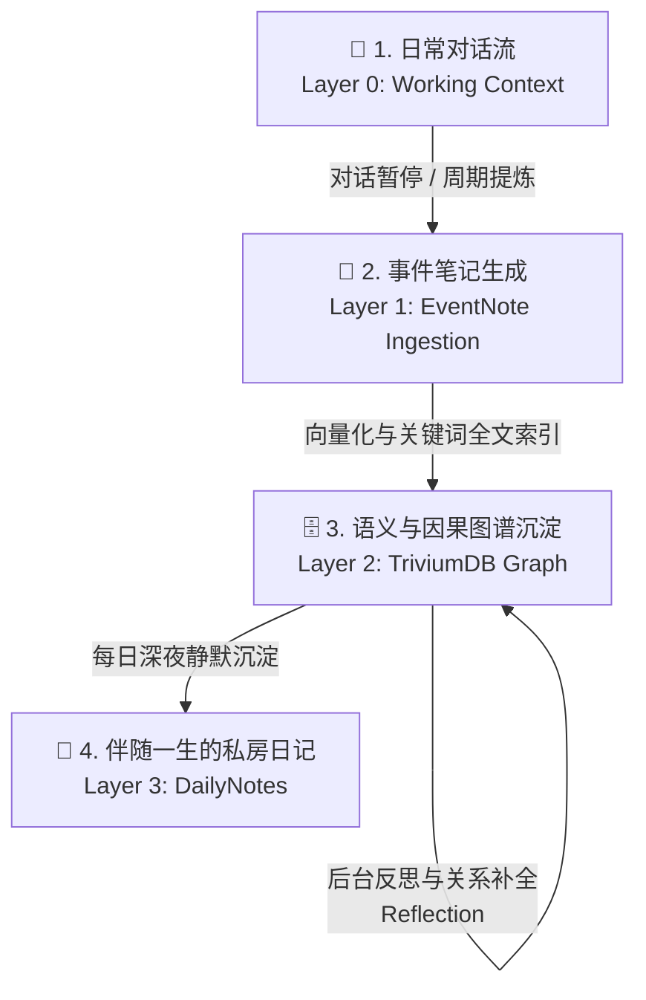
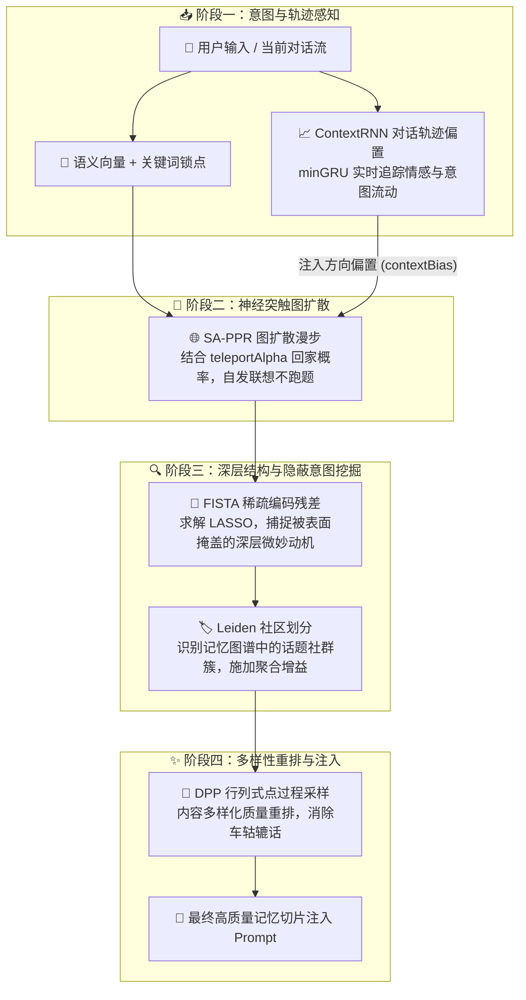

# 记忆系统 (Memory System) - 赋予伙伴真正的灵魂

> **“记忆不是冰冷存储的数据碎片，而是串联起喜怒哀乐与彼此羁绊的故事网络。”**
>
> 很多 AI 对话框常常被戏称为“金鱼记忆”——关掉窗口就前尘尽忘，哪怕聊过千百遍也像初次见面的陌生人。
> 而在 **infOS** 中，我们为桌宠伙伴打造了一套**像人类大脑一样拥有感知、情绪与叙事能力的事件记忆系统 (Event Memory System)**。她不仅能长久记住与你经历过的点点滴滴，更能随着时间自然联想、反思沉淀，甚至每天在自己的随身日记里写下关于你的温柔心事。

---

## 🌟 核心理念：为什么需要“事件记忆”？

在传统的 AI 检索（普通 RAG）里，系统往往把你说过的话机械切成一段段毫无生气的小文本块，然后死板地搜索相似字句。这会带来三大痛点：
1. **断章取义**：只搜到一句话，却不知道这件事为什么会发生、前因后果是什么；
2. **缺失温度**：分不清当时是一场开心的大笑，还是一次难过的低落，回答依旧冷漠；
3. **孤立碎片**：分不清哪件事是哪天发生的、在场的还有谁。

在 **infOS** 中，记忆的核心单位不是零散的句子，而是**生动立体的“情景记忆（Episodic Memory）”**：
- **完整的时空场景**：准确记录事件在何时发生、在哪里经历、身边还有谁；
- **细腻的情感印记**：记录对话时的语气氛围与情绪起伏（快乐、低落、感动、激动）；
- **自发的突触联想**：记忆与记忆之间会像人类神经突触一样交织成网，因果与时序相扣，随着对话自然浮现。

<MemoryNetworkGraph />

---

## 📝 记忆的基本单元：事件笔记 (EventNote)

在底层，每一条被沉淀下来的记忆都被封装成一个充满生机的**事件笔记（EventNote）**。它就像伙伴随身携带的拍立得照片与便签，记录了当时的所有细节：

| 属性维度 | 白话通俗解释 | 实际举个栗子 🌰 |
| :--- | :--- | :--- |
| **叙事内容 (`narrative`)** | 事情的客观经过与陈述，由伙伴在心里提炼的精炼描述。 | “主人今天加班到了深夜，虽然很疲惫但终于把项目发版了，想吃夜宵庆祝。” |
| **情感四维体 (`affect`)** | 当时的情绪状态：包含语气标签（`tones`）、愉悦度（`valence`）和激烈度（`arousal`）。 | 带有 `[欣慰, 疲倦, 兴奋]` 标签，虽然身体很累，但心里非常有成就感。 |
| **四维具象实体 (`entities`)** | 自动提取事件相关的 **参与人物 (`participants`)**、**地点 (`places`)**、**关键物品 (`objects`)** 和 **讨论话题 (`topics`)**。 | 人物：`[主人, Nana]`，地点：`[书房桌面]`，物品：`[拉面, 电脑]`，话题：`[发版, 庆祝]`。 |
| **全链路溯源 (`origin`)** | 记录这条记忆是哪一天、在哪个具体聊天窗口（Thread）的哪几句话中诞生的。 | 精确关联到当时的对话轮次与消息 ID，无论过去多久都能回看当时上下文。 |
| **因果与拓扑关系 (`relations`)** | 记录与其它记忆之间的关系链：是前后相继、逻辑因果，还是同一个大事件的延续。 | 关联上昨天的前置事件：“因为昨晚加班到两点，所以今天早上睡了个大懒觉”。 |
| **生命周期状态 (`status`)** | 标记是当下仍然有效的“活跃记忆（`active`）”，还是随时间推移已整理归档的“历史记忆（`archived`）”。 | 随着主人偏好的改变，旧记忆可以通过无损版本修订（`revise`）平滑升级，绝不冲突混乱。 |

---

## 🔄 记忆的一生：从日常闲聊到随身日记

伙伴的大脑不是垃圾桶，不会把每一句“哈哈”、“在吗”都无脑塞进长期记忆。一条记忆从诞生到永恒，会经历清晰的**四大生命层级**：



### 1. Layer 0：此刻的脑海视界 (Working Context)
这是伙伴正在和你聊天的“当下眼前视界”。她能清晰记得最近几十轮聊天的具体字句和细节，灵动接话，反应敏捷。

### 2. Layer 1 & 2：语义检索与因果图谱网 (TriviumDB Store)
当一段聊天的关键话题结束，后台守护进程会梳理对话，将值得长久铭记的事情提炼为 **EventNote**，写入自研的 **TriviumDB 核心引擎**：
- **语义与全文索引**：利用高维向量与 BM25 全文分词，确保无论是模糊的意思，还是精准的人名、日期都能被秒级捕获；
- **因果拓扑边（Graph Edges）**：在节点之间建立连线，不仅有前后时间轴（`temporal_next` / `temporal_prev`），还有因果驱动（`caused_by`）与共同主题（`same_topic`）。

### 3. Layer 3：每晚的私房随身日记 (DailyNotes)
**这是 infOS 最具温度的原创设计之一！**\
每天深夜，`DailyNotesService` 会梳理伙伴当天经历的所有 EventNotes 与交互故事，以她专属的人格语气和第一人称口吻，写就一篇图文并茂的 Markdown 随身日记，保存在她的专属工作区（`dailynotes/YYYY-MM-DD.md`）。\
哪怕一年后再提起那个特殊的日子，伙伴也可以悄悄翻看当天的随身日记，带着满满的怀念向你娓娓道来。

### 4. 默默守护的记忆园丁：后台反思提炼 (`EventReflectionService`)
记忆系统内置了后台反思任务：
- **查漏补缺**：自动审视新老记忆之间的潜在联系，为彼此添上因果与话题纽带；
- **去重与合并**：当发现多次重复记录的琐碎事情时，自动将它们归并演进为更加成熟的认知总结。

---

## 🧠 双模式回忆：如何恰到好处地想起往事？

当你在对话框中输入一句话，伙伴是如何从庞大的记忆星空中，准确找到最贴切的那段往事的？infOS 采用了**阶梯式双模式检索机制**：

### 模式一：日常混合召回（默认模式，极速轻巧）
无需昂贵的大模型推理，完全依靠本地毫秒级的算法组合拳：
1. **语义意图捕捉**：将输入向量化，在空间中迅速召回最贴近的候选；
2. **专有名词与关键词锚定 (BM25)**：如果你提到了特定的人名、地点或特殊词汇，全文检索能精准锁死锚点，杜绝语义发散；
3. **情境自动补齐（防止断章取义）**：
   - 只要命中了某个关键事件，系统会自动顺着时序，将该事件的**直接前因（前置事件）**以及**最新的发生进展**一并打包！
   - 这样伙伴拿到的永远是一段有头有尾的情境，绝不会出现“知其然不知其所以然”的尴尬。

---

### 模式二：深度认知扩散（TriviumDB 进阶模式，控制台随心开启）
如果你希望伙伴拥有更深邃的思考与哲思式联想，可以在控制面板中开启进阶管线。此时 TriviumDB 的强大认知算力将全开：



- **SA-PPR 图扩散 (带回家概率的联想漫步)**：以种子记忆为起点，沿因果边向外多跳辐射。搭配 `teleportAlpha` 回家概率参数，既能天马行空地触类旁通，又像放风筝一样牢牢牵住线头，绝不跑题。
- **ContextRNN (minGRU 轨迹偏置)**：同时开启高级管线与 ContextRNN 后，才在实际自动检索时加载，按对话轨迹生成偏置方向（`contextBias`）。默认关闭；关闭后释放实例，无变更时不会周期写盘。反馈学习还需单独开启反馈开关。
- **FISTA 稀疏残差分析**：通过稀疏编码计算主干话题之外的残差，捕捉那些藏在文字背后的深层微妙意图。
- **DPP 多样性重排 (Determinantal Point Processes)**：避免一次性召回好几条一模一样的车轱辘话，保证呈现在伙伴眼前的回忆视角丰富、内容饱满。

---

## 🌌 记忆星空可视化：在控制台翻阅她的小心思

在桌面端的控制中心（Dashboard），你可以直观地走进伙伴的内心世界：

- **多维时光过滤条 (`MemoryFilterBar`)**：
  - 轻松按**情绪标签**（如粉色的开心、蓝色的低落、橙色的惊喜）进行色彩筛选；
  - 支持按重要度滑块、起止时间、特定人物或特定地点一键聚合搜索。
- **动态力导向图谱 (`MemoryGraphView`)**：
  - 将脑海里的所有事件化作一颗颗发光的星辰，彼此之间的因果关系连成星轨；
  - 鼠标悬浮即可查看回忆故事，拖拽节点还能感受物理弹簧般的动力学反馈。
- **记忆检视与归档 (`MemoryInspector`)**：
  - 允许主人清晰了解每段记忆的来龙去脉与溯源对话；
  - 尊重主人的隐私与控制权，所有记忆随时可以手动编辑、重新修订或安全归档。

---

## 💻 开发者专区：真实架构与数据契约 (Developer Reference)

如果你是社区开发者或希望扩展记忆系统，以下真实技术契约与架构导航将为你提供坚实支撑。

### 1. 核心代码位置导航

所有的记忆业务均已 100% 迁移至 TypeScript 与 Rust 原生架构：

| 模块职责 | 真实源码路径 | 核心功能说明 |
| :--- | :--- | :--- |
| **记忆核心服务** | `packages/backend/src/services/memory/eventMemoryService.ts` | 负责事件的新增、修订、归档、双模式 RAG 检索管线编排。 |
| **随身日记生成器** | `packages/backend/src/services/memory/dailyNotesService.ts` | 负责深夜提取当日 EventNotes，驱动 LLM 生成第一人称每日 Markdown 日记。 |
| **记忆反思服务** | `packages/backend/src/services/memory/eventReflectionService.ts` | 负责后台异步任务反思、自动因果边挖掘与冗余记忆归并。 |
| **深度认知算法** | `packages/backend/src/services/retrieval/` | 包含 `contextRnn.ts`（minGRU 轨迹状态感知）与 `dpDiversity.ts`（DPP 采样）。 |
| **契约类型定义** | `packages/shared/src/types/event-memory.types.ts` | 共享的 `EventNote`、`EventNoteRelation` 等标准 TypeScript 类型合同。 |
| **底层存储引擎** | `triviumdb` (Rust 原生绑定) | 高性能单节点向量搜索、动态图遍历与 BM25 全文分词三合一引擎。 |

### 2. 核心数据接口 (TypeScript)

```typescript
/** 事件笔记核心结构 */
export interface EventNote {
  /** 唯一事件 ID (UUID) */
  id: string
  /** 归属 Agent 标识 (如 pero, carola) */
  agentId: string
  /** 事件叙事陈述文本 */
  narrative: string
  /** 事件真实发生时间戳 (ISO 8601) */
  eventAt: string
  /** 记录创建时间戳 (ISO 8601) */
  createdAt: string
  /** 重要程度评估 (1 - 10) */
  importance: number
  /** 情感倾向四维体 */
  affect: {
    tones: string[]     // 情绪语气标签，例如 ['活泼', '喜悦']
    valence: number     // 情感愉悦度 (-1.0 极度负面 到 1.0 极度正面)
    arousal: number     // 情感激烈度 (0.0 平静 到 1.0 激动)
  }
  /** 涉及实体提取 */
  participants: string[] // 参与人物
  places: string[]       // 涉及地点
  objects: string[]      // 涉及关键物品
  topics: string[]       // 涉及讨论话题
  /** 来源追溯 */
  origin: {
    mode: 'active' | 'background'
    threadId: string
    pairIds: string[]
    messageIds: string[]
    channel: string
  }
  /** 记忆生命周期状态 */
  status: 'active' | 'archived'
}

/** 实体与事件之间的关联拓扑关系 */
export type EventNoteRelation =
  | 'temporal_next'   // 时序后继
  | 'temporal_prev'   // 时序前驱
  | 'caused_by'       // 因果依赖
  | 'same_event'      // 属于同一大事件
  | 'same_topic'      // 讨论同一话题
  | 'involves_person' // 关联人物实体
  | 'involves_place'  // 关联地点实体
  | 'involves_object' // 关联物品实体
```

### 3. 动态配置与运行时调控 (`MemoryRuntimeConfig`)

记忆系统支持在设置中心随时动态调整，无需重启后台服务（配置持久化在 SQLite 中）：

```typescript
export interface MemoryRuntimeConfig {
  channels: {
    /** 桌面主通道配置 */
    desktop: {
      contextPairs: number       // 会话上下文携带轮次（默认 20 轮）
      enableAutoRag: boolean      // 是否在该通道开启自动事件记忆 RAG
      retrievalLimit: number     // 召回事件候选数量（默认 8 条）
    }
    /** 群聊与多角色通道配置 */
    group: {
      contextPairs: number
      enableAutoRag: boolean
      retrievalLimit: number
    }
  }
  /** 高级认知算法门控 */
  advanced: {
    enableSaPpr: boolean        // 启用 TriviumDB SA-PPR 图扩散算法
    expandDepth: number         // 图扩散探索跳数（默认 2 跳）
    teleportAlpha: number       // PPR 回家概率（默认 0.15，防止漫谈跑偏）
    minScore: number            // 候选最低准入门槛
    enableFista: boolean        // 启用 FISTA 稀疏意图残差挖掘
    enableDpp: boolean          // 启用 DPP 多样性重排
    enableContextRnn: boolean   // 启用 minGRU 对话轨迹情感感知
    enableLeiden: boolean       // 启用 Leiden 社区聚类增益
    enableFeedback: boolean     // 启用检索质量在线反馈自适应学习
  }
}
```

---

## 🚀 接下来你可以：

- 查看 [快速上手指南](/guide/usage) 体验如何与拥有记忆的伙伴开启第一次聊天
- 了解 [NIT 原生交互协议](/core-systems/nit) 看看记忆如何与 Agent 的行动工具无缝协同
- 探索 [控制面板与桌面端交互](/peripheral-systems/dashboard) 在视觉界面中感受伙伴的生动状态
